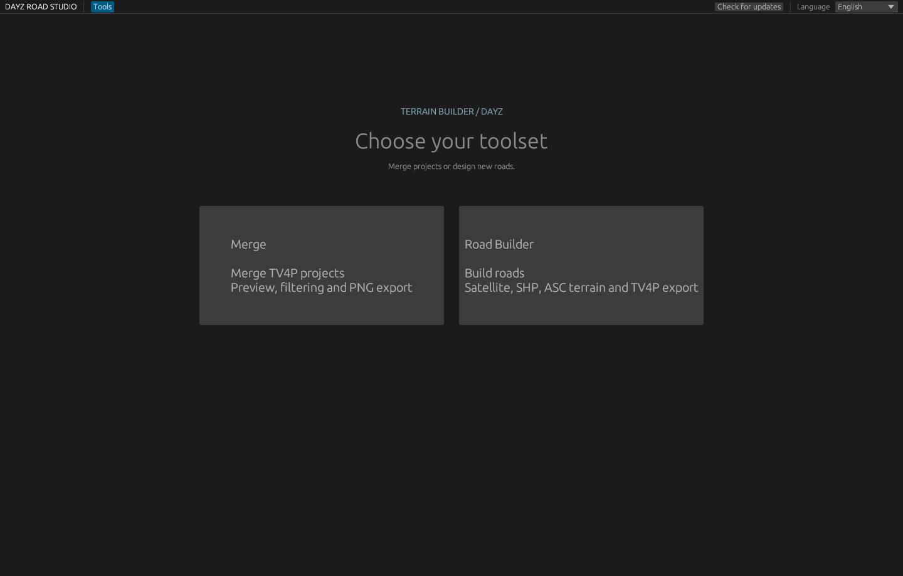
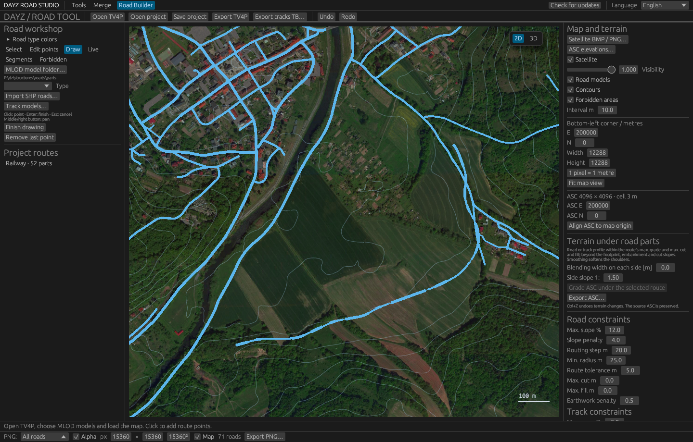
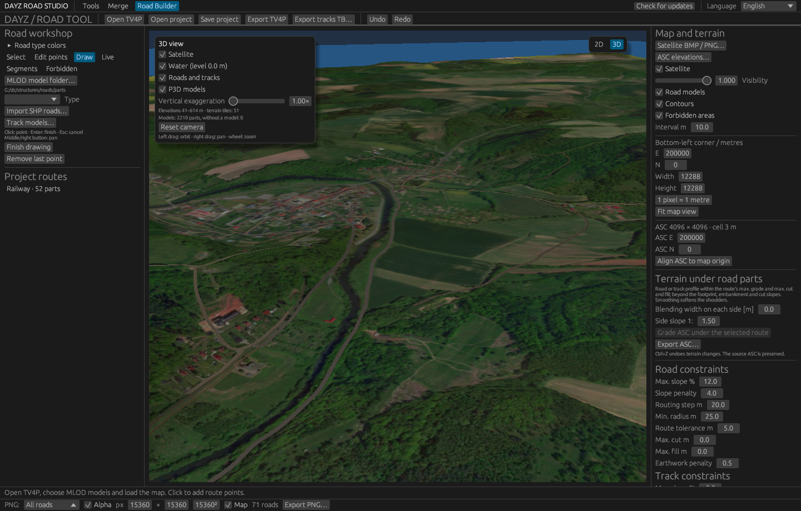
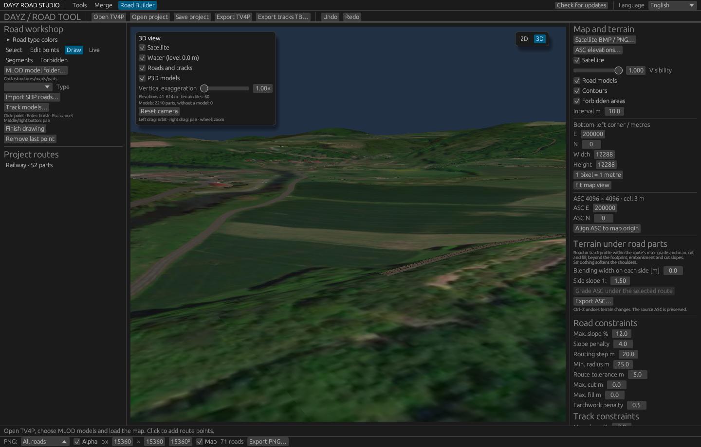
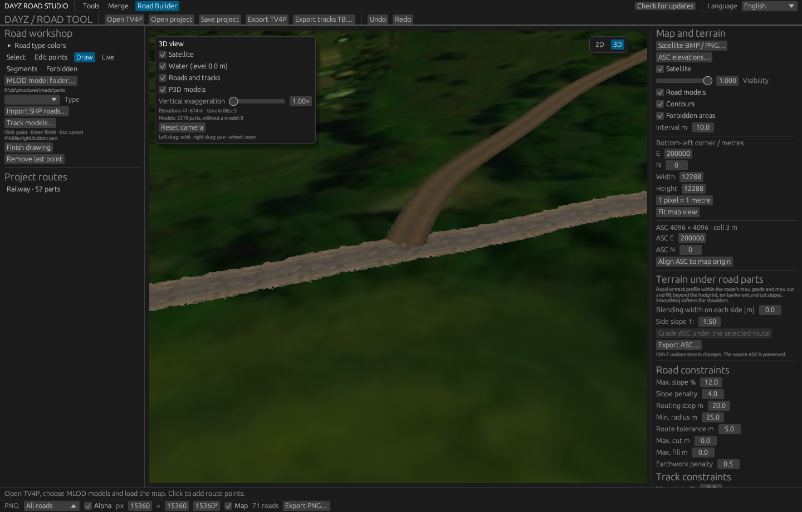
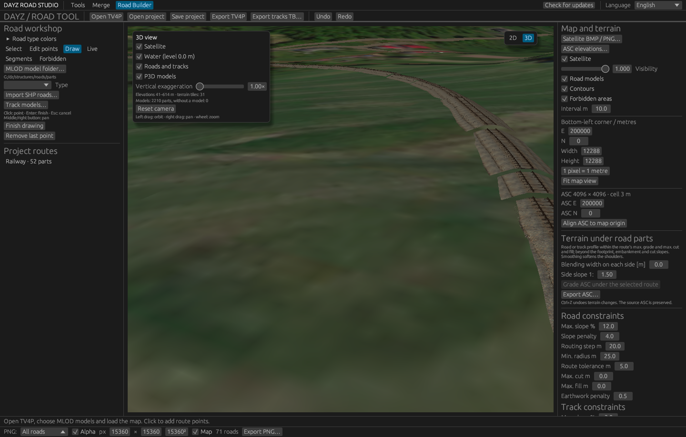
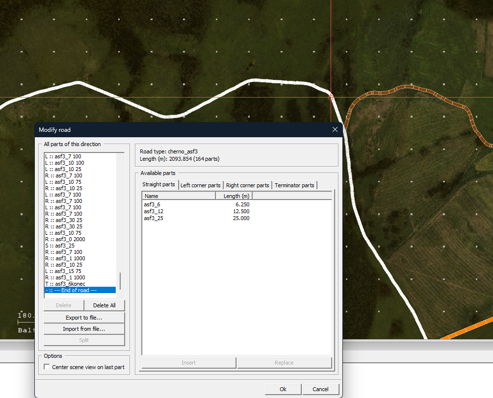

# DayZ Road Studio 2.5.2

A Windows application for merging and designing roads in Terrain Builder `.tv4p` projects. DayZ Road Studio combines **Merge** and **Road Builder** with geometry previews, terrain tools and PNG export. Written in Rust.

The same executable now includes **Road Builder**, integrated from DayZRoadToolExternal 0.1.5. Starting without a CLI command opens a launcher with **Merge** and **Road Builder**. After choosing a toolset, use the top tabs to switch; both tools retain their loaded projects, views, selections and work in progress for the current session. **Tools** returns to the launcher. The shared **Polski / English** selector covers both tools, including Builder dialogs and statuses. Background jobs continue while another tab is active. Closing checks Builder's unsaved changes even from Merge.

Road Builder includes editing existing drawn route lines, manual and live road drawing, MLOD segment fitting, SHP import, tiled satellite BMP/PNG, ASC terrain and contours, terrain routing for roads and railway tracks, cuts and embankments, grading under roads and tracks, a 3D view with the road and track P3D models, undo/redo, `.dzroad` project saving and TV4P/ASC/Terrain Builder object export. See the Road Builder sections below. To transfer work between tools, export a TV4P file and open it in the other tool; switching tabs does not transfer projects automatically. Sessions are not restored automatically after restarting.

The Builder sources are included in `crates/road-builder`; building needs no neighbouring repository or separate Builder EXE. Its TV4P and geometry implementations remain separate from Merge to preserve the original editor's export behaviour.










> [!CAUTION]
> Always keep a separate backup copy of your Terrain Builder project before merging roads or saving a result. Keep the original input projects and write the merged result to a different file.

## Acknowledgements

Special thanks to **WoozyMasta** for [tv4p-road-tool](https://github.com/WoozyMasta/tv4p-road-tool). This program was made possible by his work.

## Version

Current application version: **2.5.2** (`2.5.2` in Cargo). The application is named **DayZ Road Studio**. The executable remains `tv4p_merge_roads.exe` for compatibility with existing workflows. The version is shown in the window title and can be printed with `tv4p_merge_roads.exe --version`.

## Changes in 2.5

- **3D view** in Road Builder: a 2D / 3D switch shows the ASC terrain under the satellite image, the water level and the road and track P3D models with their PAA textures. Terrain tiles follow the camera, detailed near it and coarser towards the horizon.
- **Railway tracks**: track pieces are read from the binarised (ODOL) `Rail_Track*.p3d` models, routed across the terrain like roads with their own constraints, given level-crossing parts where they cross roads, and exported as a Terrain Builder object import file.
- **Cuts and embankments**: road and track routing may lower or raise the road against the terrain within a maximum cut and fill, and **Grade ASC under the selected route** builds that profile with side slopes.
- **Updates**: the program checks GitHub for a newer release at start, shows its notes and can download and install it.

## Changes in 2.0

- Launcher and persistent Merge / Road Builder tabs in one executable.
- Full Road Builder integration: live and manual drawing, SHP, satellite BMP/PNG, ASC, terrain routing and grading, undo/redo and `.dzroad` projects.
- Shared dark theme and Polish / English interface across both toolsets.
- Background PNG export from Builder, including map-aligned images and transparency.
- Configurable road type colors in both tools, respected by PNG export and saved in Builder projects.
- Background jobs remain active across tab changes; closing checks unsaved Builder changes from any tab.

### Earlier Merge features

- Rewritten in Rust, with road part shapes read from MLOD P3D models.
- Separate road lists and previews for A, B and the result, with filtering and selection in the list and map.
- Export selected roads only, custom PNG resolution including 15360 × 15360, and background export.
- Full map export preserving road coordinates, with the bottom left corner at (200000, 0).
- **Polski / English** language selector covering the interface, tooltips, statuses, geometry warnings and CLI messages.
- The merge result marks roads added from B with a **NEW** label and green colour. A **New roads from B only** filter is available. Selected roads are yellow. These markers describe the current merge and survive model reloads, but are not stored in TV4P files.
- The default model folder is `P:\dz\structures\roads\parts`. Models in that folder take precedence over paths stored in the project. ODOL and other non-MLOD models produce a red message above the preview; hover over it to see filenames, or inspect road warnings. Invalid models are not replaced with filename-derived geometry.

## Application language

Change the language using the selector in the top navigation bar of the application. Existing statuses and warnings also change language without reloading the project. Polish is the default; the chosen language is remembered in `%LOCALAPPDATA%\DayZRoadStudio\settings.json` and used the next time the GUI starts. Model names, paths, IDs and units stay unchanged. Standard controls in native file dialogs and operating-system error details use the Windows system language.

Use `--lang` before a command to choose the GUI or CLI language; it takes precedence over the remembered choice and does not change it. CLI commands without `--lang` use Polish:

```powershell
.\tv4p_merge_roads.exe --lang en
.\tv4p_merge_roads.exe --lang pl
.\tv4p_merge_roads.exe --lang en inspect-p3d "P:\dz\structures\roads\parts\asf2_30 25.p3d"
```

The complete application translation catalog is in `src/translations.json`. JSON exports retain stable field names; warning text uses the selected language.

Run `python tools/check_translations.py` to audit catalog coverage and message placeholders. Python is optional and is only needed for this development utility; running or building the application does not require it.

## GUI workflow

### Merge projects

1. Back up both input projects. Use **A** as the main project and **B** as the road donor. Both projects must have matching Road Tool road type and junction definitions.
2. Run `tv4p_merge_roads.exe` without a command and choose **Merge** in the launcher. For the English interface, run `.\tv4p_merge_roads.exe --lang en`, or use the language selector in the top navigation bar.
3. Check the **MLOD** folder in the top bar. Its default is `P:\dz\structures\roads\parts`. Use the `…` button beside this field to choose a folder, or edit the path and click **Apply**. Review any model warnings.
4. Click **A…** to load the main project, then **B…** to load the donor. Use **File A** and **File B** to inspect their road lists and previews.
5. Enter an output path in **Output**, or use the `…` button beside it (**Save as** in the tooltip). Choose a file different from both inputs.
6. Click **Merge roads**. On success, the application switches to **Result** and shows the merge counts. Roads actually added from B have a **NEW** label and are green; roads skipped as duplicates are not marked as new.
7. Inspect the result. Use **New roads from B only** to isolate added roads, then optionally **Select visible** to select them. Selected roads are yellow.
8. Open the saved result in Terrain Builder and check the roads and the rest of the project before adopting it as your new main project. All non-road content comes from A.

> [!NOTE]
> If merging reports incompatible Road Tool settings, resolve the definition differences in Terrain Builder before trying again. NEW markers describe the current GUI merge; they are not stored in the saved TV4P file.

### Export a PNG

1. Choose **File A**, **File B** or **Result**. Export uses the active tab, so loading both inputs or merging is not required just to preview or export one project.
2. Filter the road list if needed. Click rows or roads on the map to select them, or click **Select visible**.
3. In the bottom bar, choose **Selected roads only** or **Visible after filtering** from the PNG scope menu. Its compact label is **Selected** or **Visible**. Selected scope includes selected roads hidden by filters; visible scope includes all roads that pass the current filters.
4. Set the two **px** fields to the image width and height. The **15360²** button sets both to 15360. Enable **Alpha** for a transparent background.
5. Enable **Map** to preserve placement on the full map. Set **E** and **N** to the bottom-left world coordinates and the two **m** fields to the map width and height. For the default map, use E=200000, N=0 and 15360 × 15360 m. Disable **Map** to fit the exported roads instead.
6. Check the road count beside the export button. **Export PNG** is enabled only when this scope contains roads and another export is not running. Choose the PNG output file and wait for the success message; the large-image export runs in the background.

> [!NOTE]
> Image resolution and map size are separate settings. PNG 15360 × 15360 px over a 15360 × 15360 m map gives 1 pixel per metre. Map export clips geometry outside the configured map bounds.

### Interface reference

The A, B and Result tabs have separate road lists, selections and view settings.

Project controls remain at the top, the road list on the left, the preview in the centre and PNG export settings at the bottom. Both control bars are compact and keep their settings on one line when there is enough space; settings wrap on narrower windows. The language selector stays in the top navigation bar. Short labels and buttons provide full descriptions in tooltips. Both toolsets use the same dark theme, blue roads and yellow selections.

- Search by ID or road part names. Additional filters cover road type, length range and selected roads only.
- Click a row or road on the map to toggle selection. Selected roads are yellow. Select all visible roads or clear the selection using the corresponding buttons.
- Use the mouse wheel to zoom and drag to pan. Fit buttons cover visible or selected roads.
- Export roads visible after filtering or **selected roads only**, including selected roads hidden by a filter. The export scope shows its road count. Enter PNG width and height independently by clicking the number fields. Transparent backgrounds are supported.
- Default export covers the **full 15360 × 15360 m map**, with the bottom left corner at **E=200000, N=0**, producing a **15360 × 15360 px** image. Map size, map origin and image resolution are separate settings. These defaults give one pixel per metre.
- Full map exports preserve road placement: `x=(E−E0)×pngWidth/mapWidth`, `y=pngHeight−(N−N0)×pngHeight/mapHeight`. North is at the top. There is no margin or framing around the selection. Geometry outside the map is clipped. Disable the full map area to fit the exported roads instead.
- PNG dimensions can be 128–20480 px per side, with at most 419,430,400 pixels in total. A 15360 × 15360 image requires about 900 MiB for its RGBA buffer plus additional memory during saving. Export runs in the background without blocking the interface.

## Road geometry

Default model folder: `P:\dz\structures\roads\parts`. Change it in the application if needed. The reader uses the lowest visual LOD mesh in **MLOD P3D** files and the `LB/PB`, `LE/PE`, `LH/LD`, `PH/PD` memory points. The X/Z projection provides the actual footprint, and connection points determine the next part's placement. Road parts must be MLOD; binarised ODOL models are read only for railway tracks and for the 3D view.

> [!NOTE]
> Road previews require unbinarized MLOD P3D models. ODOL or other non-MLOD files produce a warning. A missing file may use filename-derived geometry, but an existing file in an unsupported format is not silently replaced.

A road contains a key part, its position and rotation, and separate branch chains. Rotation is read from `0x8C` in degrees using Terrain Builder's rotation direction. `0x92` extends the key part's end, `0x93` its beginning, and `0x94`/`0x95` its side connections. Left bends connect through the opposite end of the model. These field interpretations come from analysing TV4P data and models, rather than a published format specification.

When a model file is missing, the reader derives the path from its filename: length for a straight part, angle and radius for a bend. Names `6` and `12` represent 6.25 m and 12.5 m; `0 2000` represents a 0.5° bend. Arc length equals `radius × angle in radians`. Unknown names and missing connectors produce warnings rather than arbitrary substitute geometry. Row tooltips show the numbers of MLOD and filename-derived parts. Road length includes the key part and all branches.

## Merging projects

> [!NOTE]
> **Project A is the main (base) project. Project B contributes roads only.** The result keeps A's existing roads and adds roads from B that are not already present. All other project content comes from A; objects, layers, rasters and other non-road content from B are not imported.

The merger checks road type and junction definitions (`0x88`, `0x89`), skips identical roads, allocates unique IDs and rebuilds the road block. A modified or moved road may be added as a separate road. The output path must differ from both inputs. Open the result in Terrain Builder before using it in your map project.

## Command line

### CLI workflow

Run these PowerShell commands from the directory containing the executable. Replace the example filenames with your actual projects. Back up the inputs first, and choose an existing output directory.

1. Check the program version and available syntax. Optionally inspect both projects' Road Tool definitions; the merge command also checks their compatibility automatically.

```powershell
.\tv4p_merge_roads.exe --lang en --version
.\tv4p_merge_roads.exe --lang en --help
.\tv4p_merge_roads.exe --lang en types A.tv4p
.\tv4p_merge_roads.exe --lang en types B.tv4p
```

2. Merge donor B's roads into base A. The output must differ from both inputs. Stop if the command fails; do not continue exporting a result left from an earlier run.

```powershell
.\tv4p_merge_roads.exe --lang en merge A.tv4p B.tv4p output.tv4p
if ($LASTEXITCODE -ne 0) { throw "Merge failed; check the error above." }
```

3. Optionally check that the result's road block can be rebuilt byte-for-byte, then export road geometry to JSON and create an overview PNG. Pass a model folder as the last argument to `export` and `png`, or omit it to use the default folder.

```powershell
.\tv4p_merge_roads.exe --lang en roundtrip output.tv4p
if ($LASTEXITCODE -ne 0) { throw "Road block roundtrip failed." }

.\tv4p_merge_roads.exe --lang en export output.tv4p roads.json "P:\dz\structures\roads\parts"
if ($LASTEXITCODE -ne 0) { throw "JSON export failed." }

.\tv4p_merge_roads.exe --lang en png output.tv4p roads.png "P:\dz\structures\roads\parts"
if ($LASTEXITCODE -ne 0) { throw "PNG export failed." }
```

4. Review the reported geometry warnings and exported overview. To diagnose an individual road part, inspect its MLOD model:

```powershell
.\tv4p_merge_roads.exe --lang en inspect-p3d "P:\dz\structures\roads\parts\asf2_30 25.p3d"
```

5. Open `output.tv4p` in Terrain Builder and check the result before replacing your main project. `roundtrip` checks the road block only; it is not a validation of the entire project or its geometry.

> [!NOTE]
> CLI `png` exports **all roads at 2048 × 1536 px**, with an opaque background and a frame fitted to the roads. CLI currently has no options for road selection, filtering, custom resolution, transparent background or fixed map bounds. Use the GUI for selected-road exports and map-aligned PNGs such as 15360 × 15360.

> [!CAUTION]
> Output and export commands can overwrite existing destination files. Keep backups and use fresh output filenames. Successful geometry export can still report warnings and contain an incomplete preview; inspect those warnings before relying on it.

### Command reference

Put optional `--lang en` or `--lang pl` **before** the command. Exit code 0 indicates success; errors return exit code 1. Run without a command to open the GUI.

| Command | Arguments | Purpose |
| --- | --- | --- |
| `--version` / `-V` | None | Print the application version. |
| `--help` / `help` | None | Show CLI syntax. |
| `merge` | `A.tv4p B.tv4p output.tv4p` | Add B's roads to A; keep other content from A. |
| `types` | `input.tv4p` | List road type and junction definition entries. |
| `roundtrip` | `input.tv4p` | Check byte-for-byte rebuilding of the road block without modifying the input. |
| `export` | `input.tv4p output.json [models-folder]` | Export all roads and their geometry to JSON. |
| `png` | `input.tv4p output.png [models-folder]` | Export an overview PNG of all roads. |
| `inspect-p3d` | `model.p3d` | Read model length, mesh triangle count and connection ports. |

## Building

Requires Rust and Windows compilation tools:

```powershell
cargo build --release
```

Executable: `target\release\tv4p_merge_roads.exe`.

Run tests and lint checks for both toolsets with `cargo test --workspace` and `cargo clippy --workspace --all-targets -- -D warnings`. `python tools/check_translations.py` audits both translation catalogs. The optional `ui-screenshot` feature supports the eframe development screenshot mechanism; normal builds do not require it.

Road Builder also exports road geometry to PNG from its bottom bar. Choose all roads or the selected road, dimensions, alpha and map bounds. Map mode uses the origin and size in the Builder project settings; disabling it fits the image to the exported roads. Existing roads include current moves/rotations and exclude deleted/replaced roads. Generated segments are included; unfinished sketches, satellite and contours are excluded. PNG jobs continue while switching tabs.

Both left panels include **Road type colors**. Click a type swatch to choose its RGB color; **Reset** restores the default. Merge shares its palette across A, B and Result for the current session. Builder stores its palette in `.dzroad` projects, including compatibility with older projects that have no palette. Custom type colors override yellow selection and green NEW markers in PNG; preview selections remain yellow and NEW labels remain available in Merge. Unconfigured types retain their existing colors. Palettes do not alter TV4P files.

### Edit an existing drawn route

Select a route on the map or in the project route list, then choose **Edit points**. Editing goes in steps, and the left panel always says what is selected:

1. Click a route to edit it. Its points and a **+** on each stretch appear.
2. Click a point to select it. It turns yellow with a **Point N** label; only this point can be dragged, and only by grabbing it. Dragging anywhere else does nothing, so the route cannot be moved by accident.
3. Drag the selected point to move it. **Delete** or **Remove point** removes it (a route keeps at least two points), **Esc** deselects it.
4. Click a **+** to add a point halfway between its two neighbours, or double-click a line to add one exactly there. The new point is selected, ready to drag.
5. **Extend from the start** or **Extend from the end** adds points by clicking the map, with a dashed line showing the next stretch. **Enter** or **Esc** finishes.

Clicking the empty map deselects the point, and clicking it again deselects the route. Point edits clear the fitted segments; use **Fit models to points** or **Route across terrain** again before TV4P export. Undo/redo restores both the line and its fitted segments, and point edits are saved in the .dzroad project. This edits project route lines. To move a whole route or an imported road, use **Select** and start the drag on the selected road.

See [CHANGELOG.md](CHANGELOG.md) for release changes.

### Terrain grading transition width

In Road Builder, the Terrain under segments panel includes a blending width in metres per side, measured outwards from the MLOD footprint. At 0 m only the footprint changes. For example, 10 m adds a smooth transition band extending 10 m beyond the road edges, fading to the original terrain at its outer boundary. Set the width before applying terrain grading, then export ASC. The setting is stored in the project; existing projects default to 0 m. Source terrain and NoData cells remain preserved.

### Route across terrain

In Road Builder, select a drawn route and choose **Route across terrain** after loading an ASC. The route points are kept as they are: the road passes through each of them, with a continuous heading through intermediate points, and its models are fitted along the cheapest road found on the terrain. All **Road constraints** apply: **Max. slope %** limits every stretch of the fitted road, **Slope penalty** adds the total climb to the road length, **Routing step m** sets the search step, **Min. radius m** limits every curve and **Route tolerance m** keeps the road that far from forbidden areas and bounds how far the models may deviate from the line. A point at the foot of a hill and another on its top produce a longer road (serpentines, a loop or a detour) whenever the direct climb is too steep. Hard routes can take several seconds; if no road satisfies the constraints, the status names the point and the closest approach. Use **Fit models to points** to follow the drawn line itself instead.

### Water and forbidden areas

Road Builder's **Forbidden** tool draws forbidden areas and includes a **Water** section. **Avoid terrain below the water level** treats every ASC cell lower than **Water level m** (0 m by default) as forbidden, which covers the sea without drawing it. **Import water SHP…** reads Polygon, PolygonZ or PolygonM rings as forbidden areas (lakes, sea) and PolyLine, PolyLineZ or PolyLineM parts as rivers with the **River width m** chosen in the import window; coordinates are offset as in the road SHP import and the import is undone as one step. **Route across terrain**, live drawing, **Fit models to points** and the TV4P export check all avoid these areas, and terrain routing keeps at least the route tolerance away from them. **Show forbidden areas** (also **Forbidden areas** in the layer list) shows water below the level in blue, rivers as blue bands at their width and forbidden areas as red outlines. **Remove all forbidden areas** clears drawn and imported areas. Because water is forbidden, a road crossing it cannot be exported; place bridges where the water is not imported or with water detection turned off.

### Cuts, embankments and grading

**Road constraints** and **Track constraints** each have **Max. cut m**, **Max. fill m** and **Earthwork penalty**. With a cut or fill above 0 m, **Route across terrain** may lower the road into the terrain or raise it above it by up to those amounts, checks the maximum slope on that profile and adds the penalty (metres of road per m² of cut or fill along the route) to the route cost. A shorter road through a slope or over a hump then wins against a detour when the earthwork is cheaper. Both values default to 0 m, which routes exactly as before.

**Grade ASC under the selected route** designs the road or track profile within the route's maximum slope, cut and fill, sets every ASC cell under the footprint to it and builds cut and embankment slopes outside the footprint at **Side slope 1:** (1.5 m horizontally per metre by default). **Blending width on each side** softens the shoulders. The status reports the largest fill and cut. With **Adapt the terrain when generating routes** (on by default), **Route across terrain**, **Fit models to points** and finishing a live-drawn route do this automatically, as one undo step with the generation; with it off, grade the route yourself, otherwise it relies on cuts and embankments that the terrain does not have yet.

The adaptation is temporary and belongs to the route, which is marked **ASC** in the route list. The source ASC is never written. **Remove terrain adaptation** or deleting the route restores the terrain under it, Ctrl+Z works in both directions, and editing a route rebuilds its adaptation. Routes are planned over the adaptations of the other routes, and a route planned again ignores its own previous adaptation. Where adaptations overlap, the one added later wins, and removing an earlier one rebuilds those that overlap it. The settings are saved in the `.dzroad` project with the route. Only **Export ASC…** writes the terrain with its adaptations, always to a new file.

### Railway tracks

**Track models…** loads the track pieces from `P:\dz\structures\rail\Tracks` (loaded automatically when that folder exists). The `Rail_Track`, `Rail_TrackE` and `Rail_TrackSmall` families appear in the type list; their geometry is measured from the binarised ODOL models. Draw a route with a track type and use **Route across terrain**: the search is built from the real straight and curved pieces and follows **Track constraints** (maximum slope, slope penalty, routing step, minimum radius, tolerance, cut, fill and earthwork penalty).

Where a track crosses a road at 60° or more on a straight, a level-crossing part is placed: `Rail_Track_Passing_25` for standard track, `Rail_Crossing_Block` decks for `Rail_TrackE` and tiled small blocks for `Rail_TrackSmall`. Barriers are not placed.

**Export tracks TB…** writes the track pieces as a Terrain Builder object import file (`"name";X;Y;yaw;pitch;roll;1;Z;0`, where the last field is the underground flag, 0 for tracks), imported with **File › Import › Objects**. Tracks are not part of the TV4P road network. Track pieces are rigid objects that do not follow the terrain in game, so each one is tilted to lie on it: it runs from the end of the previous piece to the terrain at its own far end, so the pieces stay connected, and it leans with the side slope, with neighbouring pieces differing by at most 1°. Sloped pieces cover slightly less ground, so a long chain ends a little short of its planned end (about 0.5 m per km at a 3 % grade). Export the ASC with the same adaptations, because the heights are relative to that terrain. If the tracks lean the wrong way after import, tick **Invert pitch sign** or **Invert roll sign** and export again.

### 3D view

The **2D | 3D** switch in the top right corner of the map opens the 3D view where the 2D map was looking; switching back centres the map on the 3D camera target. Drag with the left mouse button to orbit, with the right or middle button to pan, and use the wheel to zoom.

- The ASC terrain is drawn in tiles: near the camera at the full ASC and satellite resolution, coarser with distance, so the whole map stays visible up to the horizon. Tiles load in the background in the direction the camera looks.
- **Satellite** drapes the imported satellite image over the terrain; without it the terrain is coloured by elevation.
- **Water** shows a transparent plane at the water level of the **Forbidden** tool.
- **Roads and tracks** shows the roads from the TV4P and the project routes. With **P3D models** they are drawn with their models and PAA textures. Road parts follow the terrain under every vertex. Track pieces are tilted onto the terrain exactly as the Terrain Builder export places them.
- Without models, or for parts whose P3D cannot be read, the footprint is drawn in the road type colour; the selected route keeps its yellow footprint.
- **Vertical exaggeration** (1–5×) and **Reset camera** help with flat or very large maps.

The 3D view needs OpenGL 3.0 or newer. Textures are loaded up to 256 px and RVMAT materials are not applied.

### Updates

At start the program asks GitHub for the latest release. When it is newer than the running version, a **New version X.Y.Z** button appears in the top bar and the release notes open. **Download and install** downloads the release executable, checks its size and replaces the running file; the previous file is kept as `tv4p_merge_roads.exe.old` until the next start. **Restart** closes the program through the usual unsaved-changes prompt and starts the new version. **Check for updates** in the top bar checks again; set the environment variable `DAYZ_NO_UPDATE_CHECK=1` to skip the check at start. Updating works from 2.5.0 onwards; earlier versions have to be downloaded once by hand.
